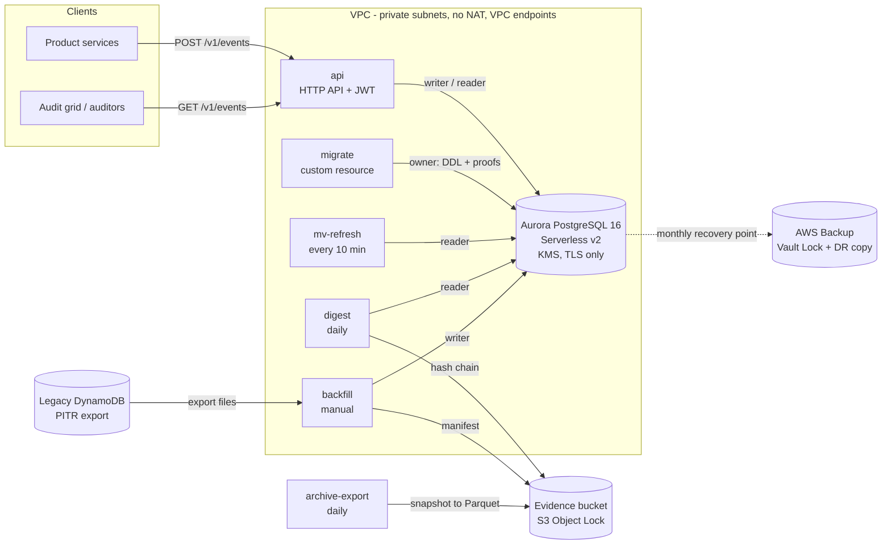
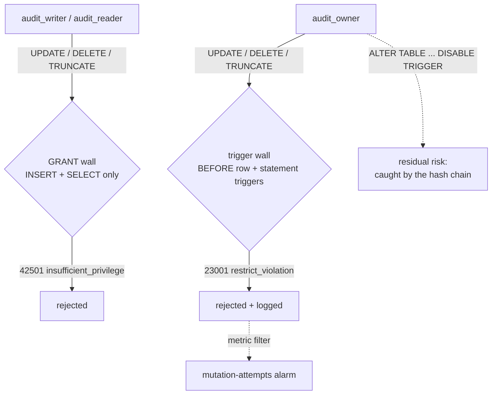
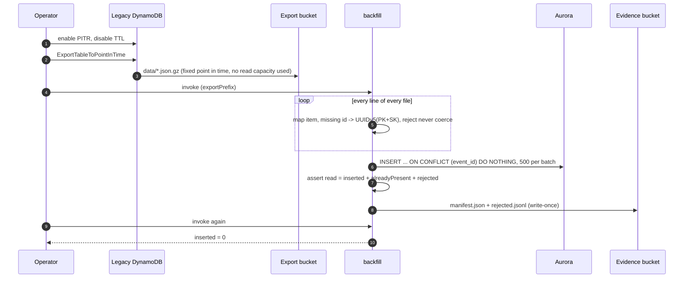

<div align="center">

# Aurora Audit Store

**Moving an append-only audit log from DynamoDB to Aurora PostgreSQL - without losing, duplicating or
quietly editing a single event, and being able to prove it.**

Aurora Serverless v2 + AWS CDK + TypeScript Lambdas: two append-only walls, schema migrations inside
the deployment, a tamper-evident hash chain in Object Lock storage, retention by locked copies, and an
idempotent, reconciled backfill from a DynamoDB point-in-time export.

[](https://github.com/the3ma/aurora-audit-store/actions/workflows/ci.yml)
[](https://github.com/the3ma/aurora-audit-store/actions/workflows/codeql.yml)


[](LICENSE)

[The problem](#the-problem) ·
[What it does](#what-it-does) ·
[Architecture](#architecture) ·
[Quick start](#quick-start) ·
[How it works](#how-it-works) ·
[Deployment](#deployment) ·
[What is verified](#what-is-verified) ·
[Docs](#documentation)

</div>

---

## The problem

A multi-tenant SaaS kept its audit log - one row per user action, to be kept unchanged for seven
years - in a single DynamoDB table with four GSIs. It was cheap and fast for "the last 50 events of
this record". Then the audit grid grew filters and auditors started asking questions:

- filter combinations were not key conditions, so reads became **scans with filters**, and because
  the page was fetched *before* filtering, **matching events silently went missing**;
- there were no totals, no deep paging and no `DISTINCT` for the filter dropdowns;
- one overloaded GSI key hid events that had both a project and a tenant;
- the 7-year "retention" was a **TTL that deleted regulated records** on schedule;
- "append-only" was a convention: any writer could overwrite or delete an item, and nothing could
  prove the log had not been edited.

The full analysis - twelve symptoms with their root causes, and the ten requirements for the
replacement - is in [docs/01-the-problem.md](docs/01-the-problem.md).

## What it does

| Capability | How |
|---|---|
| Complete, filterable reads | every filter in one parameterised `WHERE`, applied **before** `LIMIT`; keyset paging; exact counts |
| Facets and daily counts | materialized views refreshed every 10 minutes |
| Typed, unique events | enum scope, `UUID` idempotency key, JSONB `CHECK`, identity row id as the tiebreaker |
| Append-only, twice | **GRANT wall** (writer can only INSERT, `42501`) + **trigger wall** (even the owner, `23001`) |
| Proven on every deploy | 16 immutability proofs run inside the migration transaction; CI runs a **negative control** |
| Schema ships with the code | migrations as a CloudFormation custom resource, checksum-tracked, one transaction |
| Tamper evidence | daily SHA-256 **hash chain** over sealed row ranges, in an **S3 Object Lock** bucket |
| Retention by copies | monthly AWS Backup under **Vault Lock** + cross-region copy + Parquet archive; no TTL anywhere |
| Safe history move | backfill from a **PITR export**: deterministic ids, reject-never-coerce, reconciliation manifest, re-run inserts 0 |
| Least privilege | owner / writer / reader roles, separate secrets, 30-day rotation, TLS verify-full, KMS everywhere |
| Watched | alarms for capacity, connections, deadlocks, restarts, digest mismatch/age, archive freshness, mutation attempts, reads of the owner secret |

## Architecture



| Component | Path | Stack |
|---|---|---|
| Schema | [`db/migrations`](db/migrations) | PostgreSQL 16 DDL: enum, table, indexes, roles, grants, append-only triggers, materialized views |
| Core library | [`packages/core`](packages/core) | connections (secrets, rotation-safe pools, TLS), migration runner, proofs, legacy mapping, query builder, cursors |
| Functions | [`packages/functions`](packages/functions) | migrate, api (Hono), mv-refresh, digest, archive-export, backfill - Node 22 Lambdas bundled with esbuild; the same bundles run locally |
| Infrastructure | [`infra`](infra) | AWS CDK v2: Aurora, network, KMS, secrets + rotation, Object Lock, Backup, alarms, dashboard; cdk-nag |
| Local stack | [`docker-compose.yml`](docker-compose.yml) | PostgreSQL 16, LocalStack (DynamoDB, S3, CloudWatch) |

## Quick start

Requires Docker with Compose v2.

```bash
git clone https://github.com/the3ma/aurora-audit-store.git
cd aurora-audit-store
make up      # db, localstack, migrate (schema + role passwords + proofs), api
make seed    # 20,000 legacy DynamoDB items, about 4% deliberately bad (one per reject reason)
make smoke   # export -> backfill twice -> both walls -> API -> views -> digest
```

No Docker? `npm ci && npm run test:pg:local` runs the integration suite on an embedded PostgreSQL 16.
More in [docs/03-running-locally.md](docs/03-running-locally.md).

## How it works

### Two walls, proven on every deploy



Each wall holds on its own, and each fails with a different SQLSTATE, so the proofs can tell which
one stopped a statement. The proofs run in `SAVEPOINT`s against a probe row that is rolled back;
`inconclusive` never counts as a pass. CI disables the trigger and requires the owner proofs to
**fail** - evidence that the proofs can detect a hole, not just that they pass.

### Schema migrations inside the deployment

The `migrate` custom resource's only property is the SHA-256 of the migration files, so any SQL
change - and nothing else - triggers it. It applies pending files in one transaction with lock and
statement timeouts, refuses a file whose checksum changed after it was applied, sets the writer and
reader passwords (sent as SCRAM verifiers, so the plaintext never reaches the server log), runs the
proofs, and fails the deployment if any fails. Every database-using function depends on it, and a CI
**DBA gate** fails the build on destructive SQL. A **dependency-cycle test** walks the synthesized
template - it caught a real cycle (migration -> cluster construct -> rotation -> migration) that
`cdk synth` did not.

### Backfill from a point-in-time export



### Tamper evidence and retention

Every night `digest` seals closed ranges of rows - `sha256(prev_hash || sha256(rows))`, computed in
the database with the reader role - and writes each block to the Object Lock bucket, where its role
can write but not delete. Recent blocks are re-verified daily and all blocks monthly; a mismatch or a
stale digest alarms. Retention is a monthly AWS Backup recovery point under Vault Lock with a
cross-region copy, plus a monthly Parquet export of the latest snapshot for Athena. Nothing deletes
rows.

All seven decisions, with the options that were rejected, are in the [ADRs](docs/adr).

## Deployment

```bash
npm ci && cd infra && npm ci
npx cdk deploy AuditDrVault -c stage=prod -c drRegion=us-west-2      # once per account
npx cdk deploy AuditStore-prod -c stage=prod -c drRegion=us-west-2 -c vaultLockMode=compliance
```

The [deploy workflow](.github/workflows/deploy.yml) does the same, **manually triggered only** (the
capacity floor bills while idle), by the repository owner, through GitHub OIDC. Context flags, deploy
order and the full alarm list are in [infra/README.md](infra/README.md).

Rough monthly floor at list prices: **~$145 dev / ~$190 prod** - mostly the 0.5 ACU writer and the
VPC interface endpoints that replace a NAT gateway. `minAcu=0` (auto-pause) removes most of the
database floor in dev.

The cutover itself - protect the old table, backfill twice, switch writes, sign off, retire - is a
checklist in [docs/04-cutover-runbook.md](docs/04-cutover-runbook.md).

## What is verified

| | How |
|---|---|
| Schema, walls, proofs, negative control | integration tests on real PostgreSQL 16 in CI |
| API filters, keyset paging, the LIMIT-before-filter regression | integration tests + the compose smoke test |
| Backfill invariant, rejects, second run inserts 0 | integration tests + the compose smoke test (CI run: 20,000 items read, 19,179 inserted, 821 rejected with reasons; second run 0 inserted, 19,179 already present) |
| Hash chain seals and detects a rewritten row | integration tests |
| Infrastructure | 130+ CDK assertions, dependency-cycle detector, DBA gate, cdk-nag with zero unsuppressed findings, real esbuild synth |
| **Not verified** | a live Aurora deployment: rotation through the VPC endpoints, `StartExportTask` into an Object-Locked bucket, the CloudTrail-based owner-secret alarm. The stack synthesizes and is tested, but has not been deployed by the author. |

## Testing

| Suite | Command | Covers |
|---|---|---|
| Unit | `npm test` | mapping and every reject reason, UUIDv5 determinism, cursors, query parameterisation, checksum drift, error scrubbing |
| Integration | `npm run test:int` / `npm run test:pg:local` | migrations, proofs + negative control, both walls, API, backfill, digest - on PostgreSQL 16 |
| Infra | `make test-infra` | assertions, cycles, DBA gate, cdk-nag, synth |
| End-to-end | `make smoke` | the whole local stack (also runs in CI) |

## Documentation

| Document | |
|---|---|
| [01 - The problem](docs/01-the-problem.md) | the DynamoDB design, twelve symptoms, root causes, requirements |
| [02 - The solution](docs/02-the-solution.md) | mechanism by problem, runtime view, local vs AWS |
| [03 - Running locally](docs/03-running-locally.md) | stack, smoke test, troubleshooting |
| [04 - Cutover runbook](docs/04-cutover-runbook.md) | DynamoDB to Aurora, step by step, with rollback |
| [Contract](docs/CONTRACT.md) | schema, roles, secrets, env vars, legacy item, manifest, digest, API |
| [ADRs](docs/adr) | the seven design decisions |
| [infra/README.md](infra/README.md) | stacks, context flags, alarms, costs, cdk-nag suppressions |

## Roadmap

- Monthly range partitioning on `occurred_at` once a disposal policy exists (the unique `event_id`
  would have to include the partition key - a deliberate trade-off, not an oversight).
- Incremental rollups instead of full materialized-view refreshes as the table grows.
- A transactional outbox for writers whose own database cannot share a transaction with the store.
- RDS Proxy if Lambda concurrency starts to pressure connections.

## License

[MIT](LICENSE)
