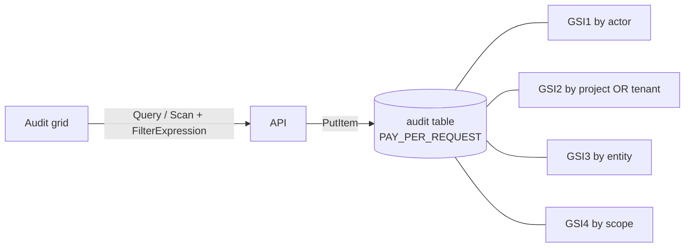

# 1. The problem: an audit log in DynamoDB

## Where we started

The product is a multi-tenant SaaS. Every user action - sign-in, record created, setting changed,
invoice voided, file downloaded - writes one row to an **audit log**. Support uses it to answer "who
changed this?", security uses it for investigations, and external auditors use it to check that the
product really records what it claims to record. The log must be **complete, unchangeable, and kept
for seven years**.

The first version put it in a single DynamoDB table:

| Key | Value |
|---|---|
| `PK` | `TENANT#<tenant>#ENTITY#<type>` |
| `SK` | `DATE#<iso timestamp>#CHANGE#<unix seconds>` |
| GSI1-4 | by actor, by project **or** tenant (one overloaded key), by entity, by scope - all `ProjectionType.ALL` |
| `ExpiresAt` | TTL = write time + 7 years |

It was cheap, it scaled, and for the first screens - "the last 50 events of this invoice" - it was
fast. Then the audit grid grew filters, and auditors started asking for exports.

## What went wrong

| # | Symptom | Root cause |
|---|---|---|
| 1 | Filtering by date range + user + action + text was slow and expensive | None of those combinations is a key condition. Reads became `Scan` with a `FilterExpression`, then more filtering in memory, in a loop capped at 100 pages. |
| 2 | **Some matching events never showed up** | The read fetched a page (`Limit`) and *then* filtered. Matching items outside that first window were silently dropped - the result looked complete but was not. For an audit log this is the worst kind of bug. |
| 3 | No "page 7 of 120", no total | DynamoDB pages forward with `LastEvaluatedKey`; there is no cheap total count and no random access, so the grid could only show "newest N". |
| 4 | Filter dropdowns (which actions? which users?) needed a scan | There is no `SELECT DISTINCT`. |
| 5 | Events with both a project and a tenant were missing from project views | GSI2 was overloaded: it held `PROJECT#...` only when the project was set, otherwise `TENANT#...`. One key cannot answer both questions. |
| 6 | A scope view without an entity type returned an arbitrary page | It fell back to a full-table `Scan`; scan order is not time order. |
| 7 | Bad data was accepted | No types: a misspelled scope, a malformed id or a non-JSON `Changes` string was stored as-is. |
| 8 | Events could collide | The sort key used `unix seconds` as the change number; two changes to the same entity in the same second overwrote each other. |
| 9 | Records were deleted automatically | The 7-year "retention" was a TTL - an *expiry*. DynamoDB deleted regulated records on schedule, with no review and no copy. |
| 10 | "Append-only" was a convention, not a control | Any principal with write access could `PutItem` over an event or `DeleteItem` it. Nothing could prove the log had not been edited. |
| 11 | Storage cost grew faster than the data | Four GSIs with `ProjectionType.ALL` stored every item five times. |
| 12 | Exports were capped and built in the browser | One read of up to 5,000 items, turned into a file client-side. |

## What the replacement had to do

1. Any combination of filters, applied **before** paging - complete results, exact counts.
2. Keyset pagination that stays correct while new events arrive.
3. Cheap facets for the filter dropdowns and daily counts for dashboards.
4. Typed, validated columns; a unique idempotency key per event.
5. **Append-only enforced by the database**, provably - not by convention.
6. **Tamper evidence** that lives outside the database, so even the database owner cannot rewrite
   history unnoticed.
7. Retention by **immutable copies**, never by deletion.
8. Encryption at rest and in transit, rotated credentials, least-privilege roles, alerting.
9. Move the existing history across **without losing or duplicating a single event**, and prove it.
10. Keep the operational cost reasonable for a log that is written all day and read in bursts.

[2 - The solution](02-the-solution.md) shows how each of these is met.
