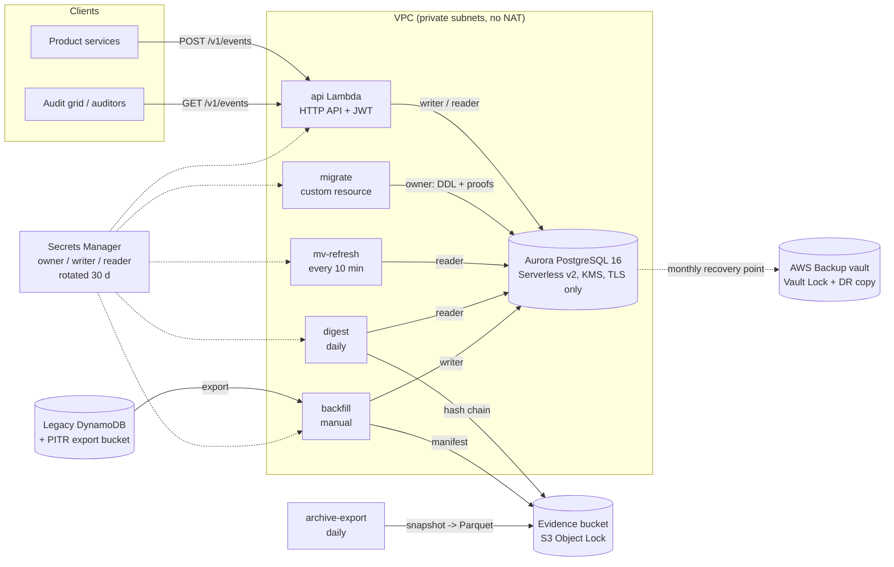

# 2. The solution: Aurora PostgreSQL with walls, seals and copies

## Mechanism by problem

| Problem (from [1](01-the-problem.md)) | Mechanism |
|---|---|
| 1, 2 Filters after paging, incomplete results | One parameterised `WHERE` with every filter null-guarded, applied **before** `LIMIT`; a regression test inserts matching rows older than the first unfiltered page and asserts they come back |
| 3 No deep paging / totals | Keyset `(occurred_at, event_row_id) < ($at, $id)` with an opaque cursor; exact `COUNT` on the same predicate |
| 4 No facets | `mv_audit_facets` and `mv_audit_daily_counts`, refreshed every 10 minutes by `refresh_audit_views()` |
| 5, 6 Overloaded key, scans | Separate columns, composite and partial btree indexes per read path, all newest-first |
| 7 No types | `audit_scope` enum, `UUID` event id, `CHECK (jsonb_typeof(changes) = 'array')`, `NOT NULL` everywhere it matters |
| 8 Collisions | `BIGINT GENERATED ALWAYS AS IDENTITY` row id as the ordering tiebreaker; `UNIQUE (event_id)` as the writer's idempotency key |
| 9 TTL deleted records | No expiry column at all. Retention = monthly AWS Backup recovery points under Vault Lock + Parquet snapshot exports in an Object Lock bucket |
| 10 Append-only by convention | **Two independent walls**: a GRANT wall (`audit_writer` can only INSERT/SELECT -> `42501`) and a trigger wall (UPDATE/DELETE/TRUNCATE raise `23001` even for the owner), verified by 16 proofs on every deploy and a negative control in CI |
| 10 Nothing proves the log is untouched | Daily **SHA-256 hash chain** over closed row ranges, written to an Object Lock bucket, re-verified on a schedule; mismatch alarms |
| 11 Storage multiplication | Btree indexes, no projected copies |
| 12 Exports | Out of scope here - see the companion [async-export-pipeline](https://github.com/the3ma/async-export-pipeline), which streams from a store like this one |
| Move history safely | **Backfill** from a DynamoDB point-in-time export: deterministic ids, reject-never-coerce, `ON CONFLICT DO NOTHING`, a manifest whose invariant `read = inserted + alreadyPresent + rejected` is asserted, and a second run that must insert 0 |

## Decisions

| ADR | Decision |
|---|---|
| [0001](adr/0001-aurora-postgres-over-dynamodb.md) | Aurora PostgreSQL Serverless v2 instead of DynamoDB (+ a search index) |
| [0002](adr/0002-two-append-only-walls.md) | Append-only enforced twice: privileges and triggers, with different error codes |
| [0003](adr/0003-schema-migrations-as-a-custom-resource.md) | Schema migrations run inside the deployment as a custom resource, gated by proofs |
| [0004](adr/0004-tamper-evidence-outside-the-database.md) | A hash chain in an Object Lock bucket, not in the database |
| [0005](adr/0005-retention-by-copies-not-ttl.md) | Retention by immutable copies, never by expiry |
| [0006](adr/0006-backfill-from-a-point-in-time-export.md) | Backfill from a PITR export, idempotent and reconciled |
| [0007](adr/0007-password-roles-over-iam-auth.md) | Rotated password roles instead of IAM database authentication |

## Runtime view

## What runs where

| | Local (docker compose) | AWS (CDK) |
|---|---|---|
| Database | PostgreSQL 16 | Aurora PostgreSQL 16, Serverless v2 (0.5-4 ACU), optional reader |
| Credentials | fixed dev passwords in env | Secrets Manager, customer-managed KMS key, 30-day rotation |
| Migrations + proofs | one-shot `migrate` container | CloudFormation custom resource, re-run when the SQL checksum changes |
| API | Node server, tenant from `X-Tenant-Id` | Lambda behind HTTP API with a JWT authorizer |
| Legacy table | LocalStack DynamoDB, seeded | the real table, PITR on, imported |
| PITR export | simulated (same S3 layout) | `ExportTableToPointInTime` |
| Evidence | LocalStack S3 | S3 with Object Lock (compliance mode in prod) |
| Backups | - | AWS Backup monthly, Vault Lock, cross-region copy |
